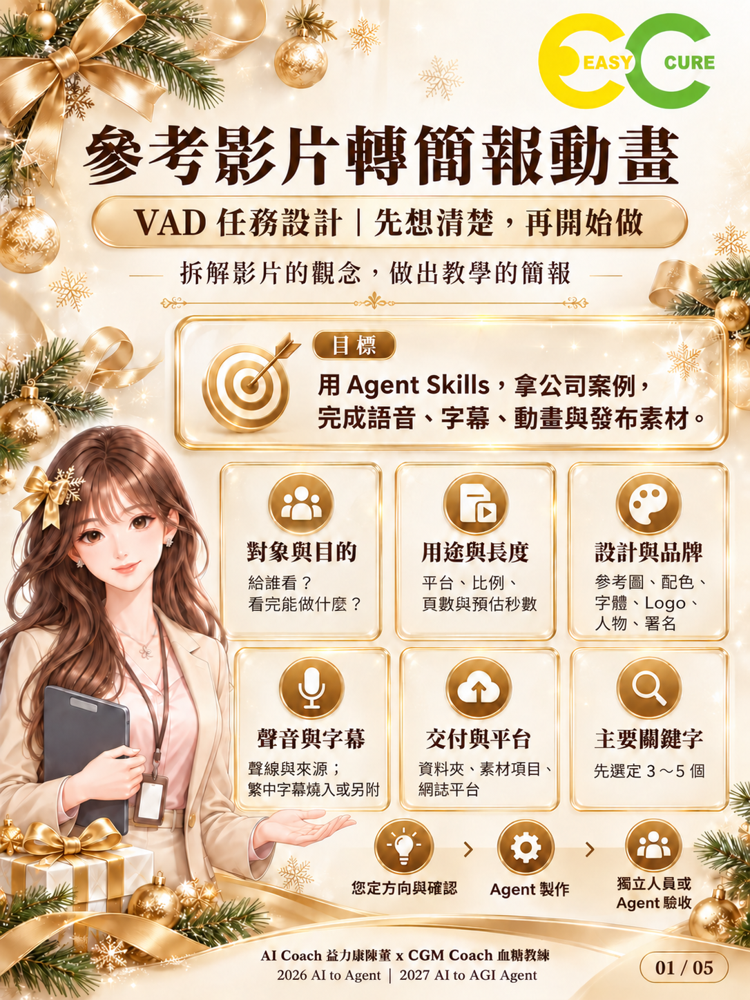

# 參考影片轉簡報動畫

用 Agent Skills，拿公司案例，完成語音、字幕、動畫與發布素材。

**ai-to-agent-video-to-slides｜v0.1.0｜2026-10-27**

這是一套 VAD／VAC 方法論與教學素材，協助企業講師、行政與內容創作者把參考影片的觀念轉成可教學的簡報動畫。這個版本提供工作規格、五張圖卡、模板與示範，不是會自動生成影片的程式，也未附可安裝的 Agent Skill。

## 快速開始

1. 準備參考影片或逐字稿，以及可公開使用的公司案例。
2. 填寫[需求表](templates/requirements.md)，確認設計、交付與主要關鍵字。
3. 將[八關工作流程](docs/workflow.md)交給 Agent，依序產出並確認。
4. 第五關鎖定內容與旁白後，才製作影片。
5. 使用[驗收表](templates/acceptance.md)核對最終成片與發布素材。

不需安裝套件。實際製作仍須具備影片讀取、語音、字幕、動畫與輸出能力的工具或 Agent Skills；工具是否可用與費用應在需求確認時記錄。

## 輸入與輸出

| 輸入 | 輸出 |
|---|---|
| 參考影片、自己的公司案例、需求表、品牌與設計素材 | 觀念摘要、內容稿、檢查報告、分鏡表、影片與指定發布素材 |
| 主要關鍵字 3～5 個、網誌平台 | 封面圖、章節時間軸、影片說明文、網誌文章、字幕檔 |

VAD 先定角色、流程與驗收；VAC 把任務落成八關。人負責方向與確認，Agent 負責製作，未參與製作的人或 Agent 負責獨立核對。

## 使用案例

[公司新人客訴教學示範](examples/customer-service.md)展示需求、內容與驗收的對應，屬於教學示範，尚未完成影片端到端實測。

適合公司內訓、課堂教學與知識影片。

## 五張圖卡

1. [VAD 任務設計](assets/cards/01-vad.png)
2. [內容撰寫與檢查](assets/cards/02-content.png)
3. [VAC 八關流程](assets/cards/03-vac.png)
4. [發布素材](assets/cards/04-publishing.png)
5. [最終驗收](assets/cards/05-review.png)

首頁使用最後確認的兩行目標文字；其餘四張保留已生成版本。「自己的案例」在本專案指經確認可使用的公司案例。

## 文件入口

- [完整流程與名詞](docs/workflow.md)
- [網誌文章](docs/blog.md)
- [分鏡表](templates/storyboard.md)
- [發布素材規格](docs/publishing.md)
- [檢查報告](docs/validation.md)
- [發布設定與步驟](docs/release.md)
- [素材來源](assets/SOURCES.md)
- [變更紀錄](CHANGELOG.md)與[貢獻方式](CONTRIBUTING.md)

## 版本與後續

v0.1.0 為首版文件與素材包。後續可加入經使用者確認的成片實測證據；本版不宣稱效率改善或搜尋排名成果。

## 授權

本 repo 採保留所有權利（All rights reserved），見 [LICENSE](LICENSE)，不是開源授權；法律權利人為 AI Coach 益力康陳董。Logo 與人物不能因同包交付而推定授權他人使用。

## 作者

AI Coach 益力康陳董 x CGM Coach 血糖教練

2026 AI to Agent | 2027 AI to AGI Agent
